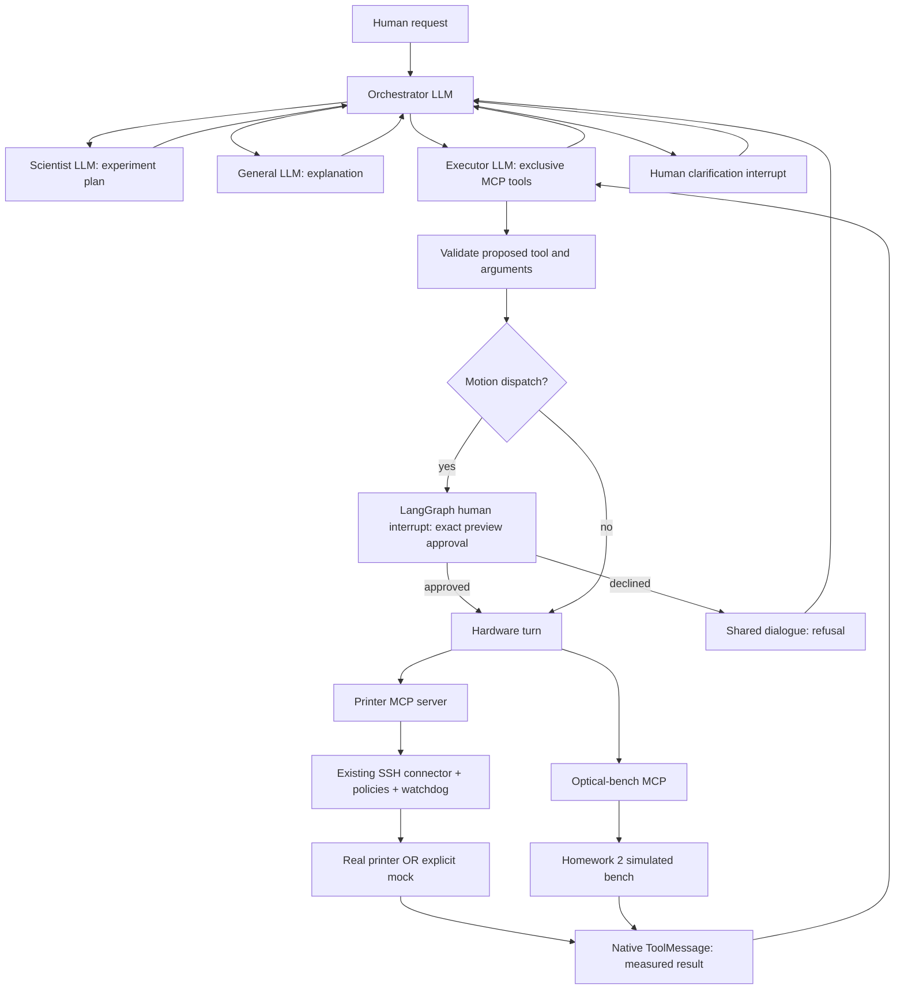
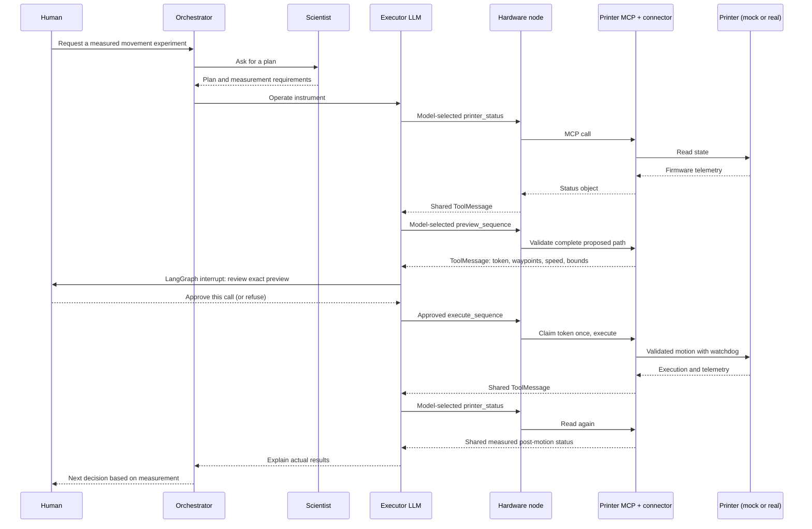

# Architecture and sequence diagrams

The architecture supports these branches; actual run order is recorded in each
audit file. Scripted examples demonstrate transport/graph behavior only. A real
LLM/real-hardware sequence and video still need operator capture.
